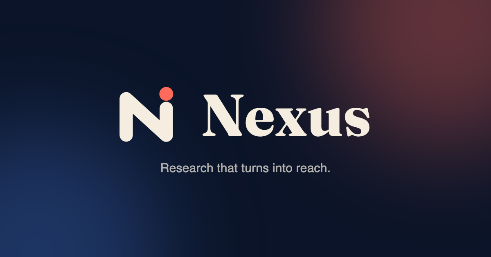
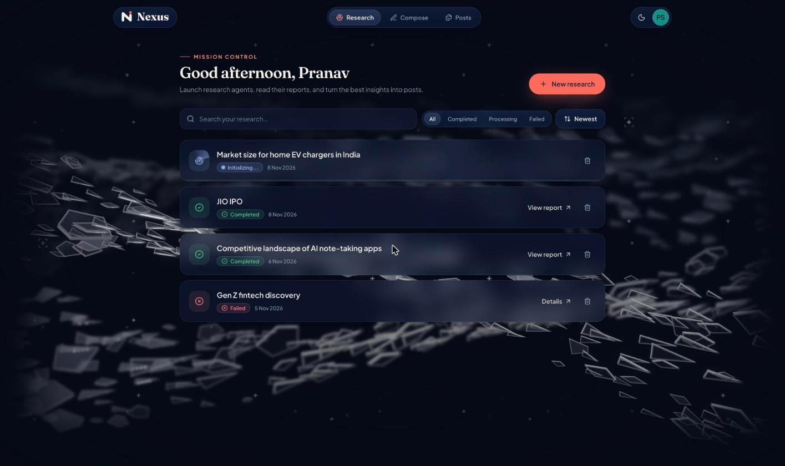
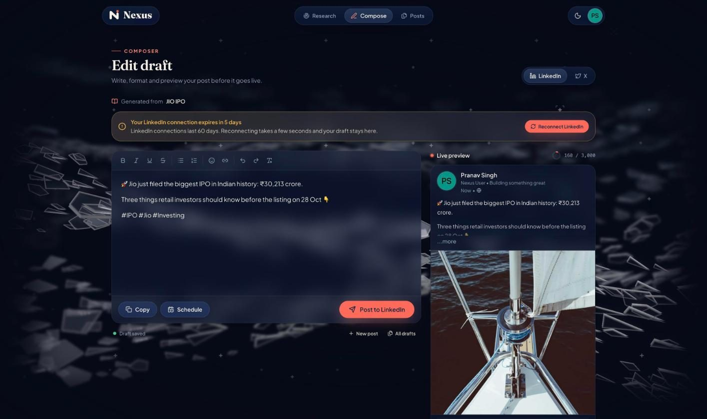
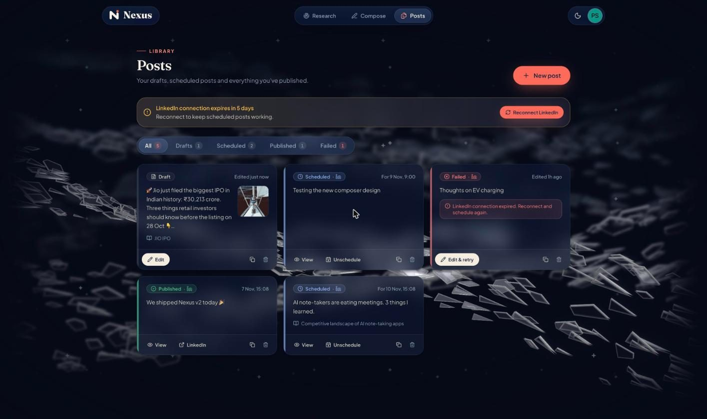

<h1 align="center">Hi, I'm Pranav 👋</h1>

  

# 💫 About Me:
Aspiring **AI/ML developer** passionate about building scalable solutions. I've solved **250+ coding problems** across platforms, with a **CodeChef 2-star (1300+)** and **Codeforces 900+** ratings. Currently pursuing a **B.Tech in CS & AI** at Newton School of Technology.

Right now I'm building **[Nexus](https://github.com/Pranav-Singh-Devloper/nexus-project)**, an agentic AI app that researches a market and turns the findings into LinkedIn posts.

## 🌐 Socials:
     

# 🚀 Featured project: Nexus

**Research that turns into reach.** You ask Nexus a market question. An AI agent searches the live web, writes a cited report, and turns it into a LinkedIn post with an AI-generated image, ready to publish or schedule.

  
  

| Research dashboard | Post composer | Posts library |
| :---: | :---: | :---: |
|  |  |  |

- **Research agent:** a LangGraph loop (reason → search → reason) on `gpt-oss-120b` via Groq, with Tavily web search.
- **Hybrid search:** pgvector embeddings plus keyword matching across every report.
- **Posts:** LinkedIn post + image generation, a rich-text composer with live preview, autosaved drafts, scheduling, and LinkedIn/X publishing.
- **Stack:** React 19 + Vite on Vercel · Node/Express + Prisma on Railway · FastAPI on Railway · Neon Postgres.
- **Design:** iOS-style liquid-glass UI, light and dark themes, and a WebGPU shard background.

### 🐍 Contribution Snake
<picture>
  <source media="(prefers-color-scheme: dark)" srcset="https://raw.githubusercontent.com/Pranav-Singh-Devloper/Pranav-Singh-Devloper/output/github-contribution-grid-snake-dark.svg" />
  <source media="(prefers-color-scheme: light)" srcset="https://raw.githubusercontent.com/Pranav-Singh-Devloper/Pranav-Singh-Devloper/output/github-contribution-grid-snake.svg" />
  
</picture>

# 💻 Tech Stack:

**Languages:**     

**Frontend:**     

**Backend & data:**     

**AI/ML:**     

**Deploy & tools:**    

# 📄 Resume Highlights:

## 🎓 Education
- **B.Tech (CS & AI)** | Newton School of Technology | 2024–2028
- **Class XII** | Heera Lal Public School | 2023–2024
- **Class X** | Navy Children School | 2021–2024

## 💼 Internships
### AI/ML Development Intern | The MA Studio | May 2025–June 2025
- Built a hybrid search–retrieval system (BM25 + 70B Transformer).
- Engineered prompt templates and built scalable Streamlit pipelines.

## 🚀 Projects
- **[Nexus: Autonomous Market Intelligence](https://github.com/Pranav-Singh-Devloper/nexus-project)** | [Demo](https://nexus-ai-swarm.vercel.app)
  - LangGraph research agent, pgvector hybrid search, LinkedIn post + image generation, and scheduling. React, Node/Express, FastAPI, Neon Postgres.
- **[Movie Sentiment Analyser](https://github.com/Pranav-Singh-Devloper/movie_sentiment_analysis)** | [Demo](https://huggingface.co/spaces/pranav-singh-developer-1/movie-sentiment-analysis)
  - TensorFlow 2.15, Streamlit. 88% accuracy.
- **[RealEstate Website](https://github.com/Pranav-Singh-Devloper/realEstate.git)** | [Demo](https://home-rental-website-pranav-singhs-projects-734825bb.vercel.app/)
  - Next.js, Tailwind, TypeScript, Shadcn UI.

## 🏆 Extra-Curriculars
- Represented Haryana at **National Youth Festival** (Top 3000/30L).
- **Secretary** of GDG, Rishihood University.
- Finalist (Top 7), Smart India Hackathon 2024.

# 📊 GitHub Stats:

---

