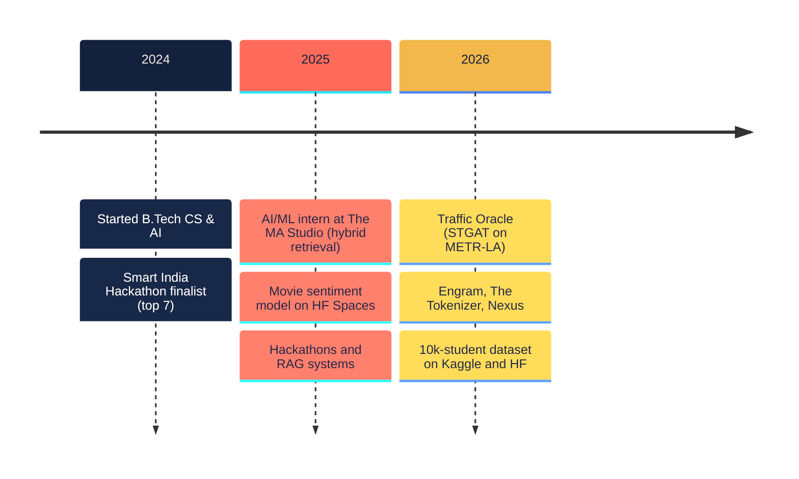

<a href="https://github.com/Pranav-Singh-Devloper">
  <picture>
    <source media="(prefers-color-scheme: dark)" srcset="assets/header-dark.svg">
    
  </picture>
</a>

<p align="center">
  
</p>

<p align="center">
  <a href="https://www.linkedin.com/in/pranav-singh-08155a244/"></a>
  <a href="mailto:pranav.singh2024@nst.rishihood.edu.in"></a>
  <a href="https://huggingface.co/pranav-singh-developer-1"></a>
  <a href="https://www.kaggle.com/pranavsinghdeveloper"></a>
  <a href="https://leetcode.com/u/hawkeye_1/"></a>
  <a href="https://codeforces.com/profile/hawkeye_1"></a>
  <a href="https://www.codechef.com/users/hawkeye_1"></a>
  
</p>

$$\theta^{\ast}_{\text{pranav}} = \arg\min_{\theta}\ \mathbb{E}_{x\sim\text{real problems}}\left[\mathcal{L}_{\text{shipped}}(x;\theta)\right]$$

<details>
<summary><b>⚡ The 30-second version</b> &nbsp;<sub>(for recruiters)</sub></summary>
<br>

- **Who:** B.Tech CS & AI student at Newton School of Technology (2024–2028). I build LLM systems and test them properly.
- **Built:** [Engram](https://github.com/Pranav-Singh-Devloper/Engram), memory for AI agents that tracks *when* each fact was true; [The Tokenizer](https://github.com/Pranav-Singh-Devloper/The_Tokenizer), three tokenizer families from scratch that match GPT-2 token for token; [Nexus](https://github.com/Pranav-Singh-Devloper/nexus-project), a LangGraph research agent that writes cited reports.
- **Experience:** AI/ML Development Intern at The MA Studio (2025): hybrid BM25 + 70B-LLM retrieval, Streamlit pipelines.
- **Also:** Smart India Hackathon 2024 finalist (top 7) · Secretary, GDG Rishihood · represented Haryana at the National Youth Festival.
- **Looking for:** AI/ML internships and open-source collaborations. [Email me.](mailto:pranav.singh2024@nst.rishihood.edu.in)

</details>

## `model_card.yaml`

<!--CARD:START-->
```yaml
model_id:      pranav-singh/ai-ml-engineer
base_model:    B.Tech CS & AI, Newton School of Technology (2024–2028)
fine_tuned_on:
  - AI/ML intern @ The MA Studio (2025): hybrid BM25 + 70B retrieval
  - agent memory, tokenizers, RAG, graph neural nets, evaluation
capabilities:  [llm-agents, rag, agent-memory, tokenization, gnns, a/b-tests]
languages:     [python, typescript, c++, sql]
evals:
  public_repos:             42
  contributions_last_12mo:  819
  leetcode_contest_rating:  1406
  leetcode_solved:          56
  codeforces_max_rating:    1079
  codechef:                 2★
  smart_india_hackathon:    finalist, top 7 (2024)
known_limitations:
  - rebuilds things from scratch to understand them
  - won't ship a README without a benchmark table
license:       MIT unless the repo says otherwise
last_trained:  2026-11-08  # refreshed daily by a GitHub Action
```
<!--CARD:END-->

## 🧪 Flagship work

<table>
<tr>
<td colspan="2">

<a href="https://huggingface.co/datasets/pranav-singh-developer-1/engram-media/resolve/main/engram-film-1080p.mp4"></a>

### [Engram](https://github.com/Pranav-Singh-Devloper/Engram) &nbsp;·&nbsp; memory for AI agents
Agents forget everything between sessions, and similarity search can't tell which of two contradicting messages is current. Engram stores every fact with **two timelines: when it was true, and when it was believed**. It resolves contradictions, forgets what nobody needs and consolidates conversations overnight. Agents use it over **MCP**.

`TypeScript` `Postgres + pgvector` `MCP · 6 tools` `LongMemEval-S` · [**live demo**](https://engram-lime.vercel.app) · [architecture](https://engram-lime.vercel.app/architecture) · [4-min film](https://huggingface.co/datasets/pranav-singh-developer-1/engram-media/resolve/main/engram-film-1080p.mp4)

</td>
</tr>
<tr>
<td width="50%" valign="top">

<a href="https://github.com/Pranav-Singh-Devloper/The_Tokenizer"></a>

### [The Tokenizer](https://github.com/Pranav-Singh-Devloper/The_Tokenizer)
BPE, byte-level BPE and WordPiece written from scratch in pure Python with zero dependencies, plus an in-browser visualizer that runs the real algorithms step by step.

> **Token-for-token identical to GPT-2** on 338,025 tokens of Shakespeare · 48 + 9 parity tests · 5 experiments

[**live**](https://the-tokenizer.vercel.app) · [2-min explainer](https://huggingface.co/datasets/pranav-singh-developer-1/the-tokenizer-video) (Manim + Remotion)

</td>
<td width="50%" valign="top">

<a href="https://github.com/Pranav-Singh-Devloper/nexus-project"></a>

### [Nexus](https://github.com/Pranav-Singh-Devloper/nexus-project)
Ask a market question. A **LangGraph** agent plans, searches the live web, loops until it can answer, and writes a cited Markdown report. One click turns the report into a LinkedIn post with an AI-generated image.

> Reports searchable **by meaning** (pgvector) · drafts, scheduling and publishing in one place

`React 19` `FastAPI` `LangGraph` `Groq` · [**live**](https://nexus-ai-swarm.vercel.app)

</td>
</tr>
</table>

### 📊 Results table

| project | task | headline result | stack |
|:--|:--|:--|:--|
| [**Traffic Oracle**](https://github.com/Pranav-Singh-Devloper/traffic-oracle) | 5–60 min freeway speed forecasting on METR-LA | I own the deep-learning core: GAT layer, **STGAT**, GRU baseline, trainer · [demo](https://traffic-oracle.streamlit.app/) | PyTorch · graphs |
| [**ML A/B Testing**](https://github.com/Pranav-Singh-Devloper/ml-ab-testing) | LogReg vs RF vs HistGB on 15 OpenML-CC18 datasets | A naive t-test calls RF vs GB "significant" on **11/15** datasets; the 5×2cv test on **1/15**. The test you pick changes the headline. | scikit-learn · stats |
| [**Indian CS Student Survival**](https://github.com/Pranav-Singh-Devloper/indian-cs-student-survival-dataset) | Synthetic dataset for practising classical ML | 10,000 students · 59 features · 7 hidden personas · on [Kaggle](https://www.kaggle.com/datasets/pranavsinghdeveloper/desi-cs-student-survival) and [HF](https://huggingface.co/datasets/pranav-singh-developer-1/indian-cs-student-survival) | pandas · Streamlit |
| [**Viberon**](https://github.com/Pranav-Singh-Devloper/viberon-dmg) | AI dev environment with parallel specialist agents | Agents navigate a **symbol graph** of the codebase instead of reading whole files | TypeScript · agents |
| [**ColdCase RAG**](https://github.com/Pranav-Singh-Devloper/ColdCase_RAG) | Evidence Q&A over case files | Every claim cites a retrieved chunk | FAISS · LangChain · Groq |
| [**Telecom Churn**](https://github.com/Pranav-Singh-Devloper/telecom_churn_prediction) | Churn prediction with explanations | Cost-sensitive threshold (0.3) + SMOTE · [Space](https://huggingface.co/spaces/pranav-singh-developer-1/telecom-churn-predictor) | scikit-learn · Gradio |
| [**RankShift**](https://github.com/Pranav-Singh-Devloper/RankShift-contest-rating-engine) | Contest rating engine | Rating update as a steady-state **Kalman filter** (K = 0.5) · [frontend](https://rank-shift-contest-rating-engine.vercel.app) | TypeScript · Postgres |
| [**Movie Sentiment**](https://github.com/Pranav-Singh-Devloper/movie_sentiment_analysis) | IMDb review classification | 88% accuracy · [Space](https://huggingface.co/spaces/pranav-singh-developer-1/movie-sentiment-analysis) | TensorFlow · Streamlit |

## 📈 Training run

<picture>
  <source media="(prefers-color-scheme: dark)" srcset="assets/generated/training-run-dark.svg">
  
</picture>

<sub>Drawn by <a href="scripts/build_profile.py"><code>scripts/build_profile.py</code></a> (standard-library Python) every day at 00:00 UTC. No third-party stats service, so it doesn't go down.</sub>

### 🚢 Recently shipped
<!--RECENT:START-->
| repo | what | lang | pushed |
|:--|:--|:--|:--|
| [**nexus-project**](https://github.com/Pranav-Singh-Devloper/nexus-project) | Research agent → cited market report → LinkedIn post, end to end | `JavaScript` | today |
| [**the-daily-algorithm**](https://github.com/Pranav-Singh-Devloper/the-daily-algorithm) | The Daily Algorithm — newspaper-editorial AI/ML portfolio of Pranav Singh | `JavaScript` | 4 days ago |
| [**The_Tokenizer**](https://github.com/Pranav-Singh-Devloper/The_Tokenizer) | BPE, byte-level BPE and WordPiece from scratch, GPT-2 parity, live visualizer | `Python` | 5 days ago |
| [**Engram**](https://github.com/Pranav-Singh-Devloper/Engram) | Bitemporal memory for AI agents, served over MCP (Postgres + pgvector) | `TypeScript` | 5 days ago |
| [**ml-ab-testing**](https://github.com/Pranav-Singh-Devloper/ml-ab-testing) | Statistically rigorous A/B test of 3 models on 15 OpenML-CC18 datasets | `Python` | 5 days ago |
<!--RECENT:END-->

## 🏙️ Contribution skyline

<picture>
  <source media="(prefers-color-scheme: dark)" srcset="assets/generated/skyline-dark.svg">
  
</picture>

## 🛤️ Trajectory



## 🧰 Toolchain

<p>
  <b>ML & data</b><br>
  <br>
  
  
  
  
  
  
  
  
  
  
</p>
<p>
  <b>Backend & infra</b><br>
  
</p>
<p>
  <b>Frontend & languages</b><br>
  
</p>

<details>
<summary><b>📄 Full résumé</b></summary>
<br>

**Education**
- **B.Tech, Computer Science & AI** · Newton School of Technology · 2024–2028
- Class XII · Heera Lal Public School · 2023–2024
- Class X · Navy Children School

**Experience**
- **AI/ML Development Intern** · The MA Studio · May–Jun 2025
  - Built a hybrid search-and-retrieval system (BM25 + 70B transformer).
  - Engineered prompt templates and built scalable Streamlit pipelines.

**Leadership & awards**
- Finalist (top 7), Smart India Hackathon 2024
- Secretary, Google Developer Group (GDG), Rishihood University
- Represented Haryana at the National Youth Festival (top 3,000 of 30 lakh)

**Competitive programming:** 250+ problems · LeetCode contest rating 1400+ · CodeChef 2★ · Codeforces max 1079

</details>

---

<picture>
  <source media="(prefers-color-scheme: dark)" srcset="assets/generated/snake-dark.svg">
  
</picture>

<p align="center">
  <sub>The header, training run, skyline and snake are drawn by this repo's own <a href=".github/workflows/refresh-profile.yml">GitHub Action</a>. Fork the setup if you like it.</sub>
</p>
