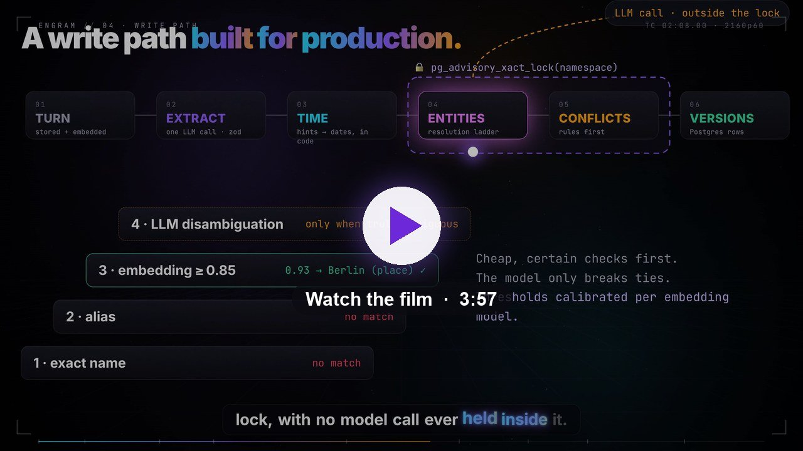
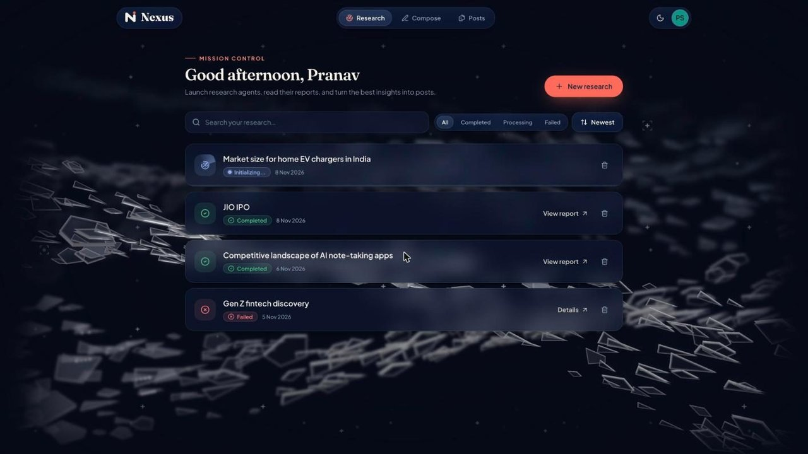
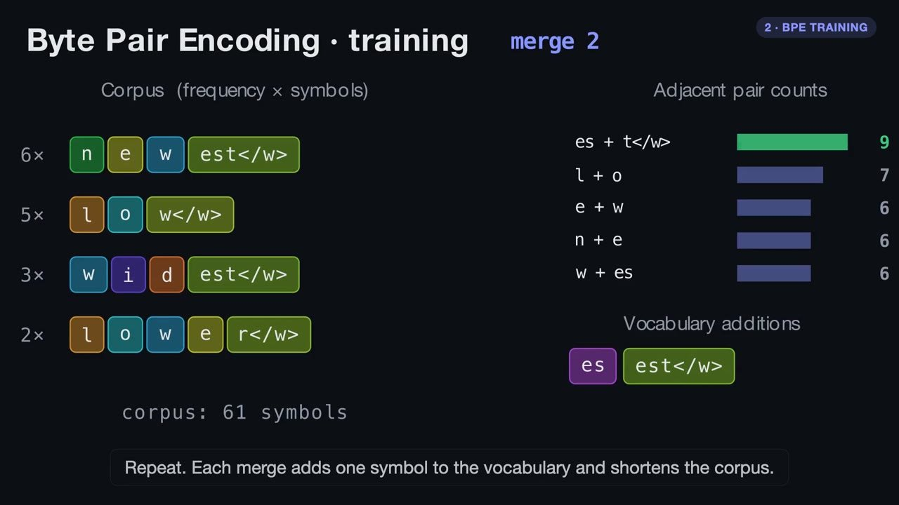
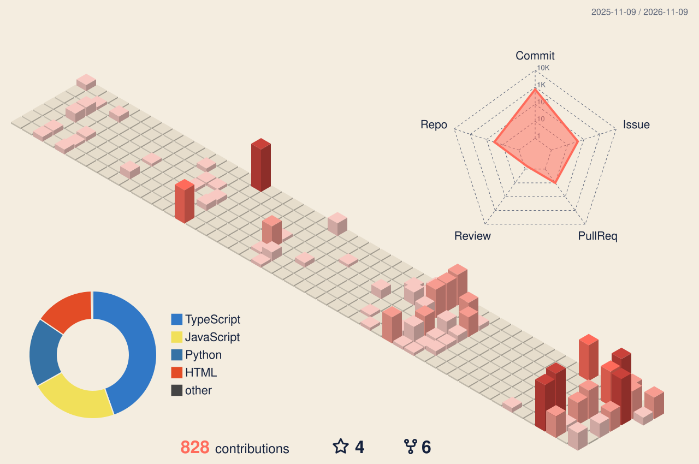
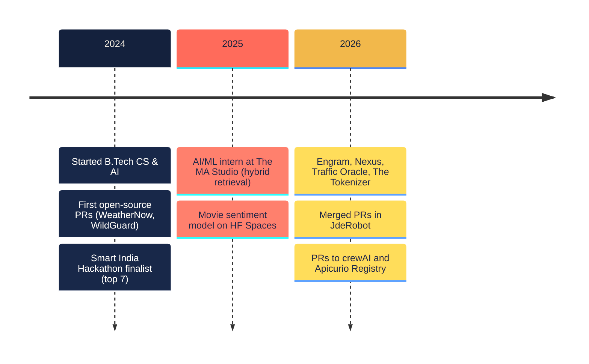

<a href="https://github.com/Pranav-Singh-Devloper">
  
</a>

<p align="center">
  
</p>

<p align="center">
  <a href="mailto:pranav.singh2024@nst.rishihood.edu.in"></a>
  <a href="https://www.linkedin.com/in/pranav-singh-08155a244/"></a>
  <a href="https://huggingface.co/pranav-singh-developer-1"></a>
  <a href="https://www.kaggle.com/pranavsinghdeveloper"></a>
  
  
</p>

$$\theta^{\ast}_{\text{pranav}} = \arg\min_{\theta}\ \mathbb{E}_{x\sim\text{open issues}}\left[\mathcal{L}_{\text{merged}}(x;\theta)\right]$$

## Open source × AI/ML

> I learn a system by reading its source, and I say thanks by fixing what I find.

- **Upstream:** robotics with deep learning at JdeRobot, agent frameworks at crewAI, API tooling at Apicurio. I reproduce the bug, file the issue, then send a small, focused fix.
- **In the open:** my own AI/ML work is public, with tests, CI and written design decisions, so anyone can pick it up ([how I work](#-how-i-work)).
- **Drawn to:** LLM tooling (agents, memory, retrieval, evaluation), time-series and graph ML, and robots that learn.
- **Say hi:** [email](mailto:pranav.singh2024@nst.rishihood.edu.in) · [LinkedIn](https://www.linkedin.com/in/pranav-singh-08155a244/) · IST (UTC+5:30). Always happy to pair on an issue.



## Upstream contributions

<!--UPSTREAM:START-->
**6 merged · 4 in review · 6 repositories** <sub>(auto-updated daily)</sub>

| | project | pull request | status | opened |
|:-:|:--|:--|:--|:--|
|  | [JdeRobot/RoboticsAcademy](https://github.com/JdeRobot/RoboticsAcademy) <sub>★ 512</sub> | [Show the real reason when an exercise can't be opened](https://github.com/JdeRobot/RoboticsAcademy/pull/4111) | 🟢&nbsp;in&nbsp;review | Nov 2026 |
|  | [JdeRobot/RoboticsApplicationManager](https://github.com/JdeRobot/RoboticsApplicationManager) <sub>★ 12</sub> | [Send user code stderr to the exercise console](https://github.com/JdeRobot/RoboticsApplicationManager/pull/307) | 🟣&nbsp;merged | Nov 2026 |
|  | [JdeRobot/RoboticsAcademy](https://github.com/JdeRobot/RoboticsAcademy) <sub>★ 512</sub> | [Only send GUI messages once the websocket is connected](https://github.com/JdeRobot/RoboticsAcademy/pull/4101) | 🟣&nbsp;merged | Nov 2026 |
|  | [Apicurio/apicurio-registry](https://github.com/Apicurio/apicurio-registry) <sub>★ 951</sub> | [fix(rest): normalize pagination parameters in v3 groups endpoints](https://github.com/Apicurio/apicurio-registry/pull/10854) | 🟢&nbsp;in&nbsp;review | Nov 2026 |
|  | [crewAIInc/crewAI](https://github.com/crewAIInc/crewAI) <sub>★ 60.7k</sub> | [fix(tools): let DirectoryReadTool list its declared directory outside cwd](https://github.com/crewAIInc/crewAI/pull/9072) | 🟢&nbsp;in&nbsp;review | Nov 2026 |
|  | [JdeRobot/RoboticsAcademy](https://github.com/JdeRobot/RoboticsAcademy) <sub>★ 512</sub> | [Use model_path_func in DL exercise example code](https://github.com/JdeRobot/RoboticsAcademy/pull/4097) | 🟣&nbsp;merged | Nov 2026 |
|  | [JdeRobot/RoboticsAcademy](https://github.com/JdeRobot/RoboticsAcademy) <sub>★ 512</sub> | [Fix broken image paths in exercise docs](https://github.com/JdeRobot/RoboticsAcademy/pull/4095) | 🟣&nbsp;merged | Nov 2026 |
|  | [crewAIInc/crewAI](https://github.com/crewAIInc/crewAI) <sub>★ 60.7k</sub> | [fix(flow): restore state for method-level @persist on resume and fork](https://github.com/crewAIInc/crewAI/pull/9021) | 🟢&nbsp;in&nbsp;review | Nov 2026 |
|  | [R0Y15/WeatherNow](https://github.com/R0Y15/WeatherNow) <sub>★ 38</sub> | [Fixed the UI and UX of Navigation bar on issue #128](https://github.com/R0Y15/WeatherNow/pull/132) | 🟣&nbsp;merged | Oct 2024 |
|  | [anuragverma108/WildGuard](https://github.com/anuragverma108/WildGuard) <sub>★ 210</sub> | [Improved the UI of the "Share your thoughts section"](https://github.com/anuragverma108/WildGuard/pull/1471) | 🟣&nbsp;merged | Oct 2024 |
<!--UPSTREAM:END-->

## Flagship projects

<table>
<tr>
<td width="50%" valign="top">

<a href="https://github.com/Pranav-Singh-Devloper/Engram"></a>

### [Engram](https://github.com/Pranav-Singh-Devloper/Engram)
Memory for AI agents that stores every fact with **two timelines: when it was true, and when it was believed**. It resolves contradictions, forgets what nobody needs and serves agents over **MCP**.

> 6 MCP tools · benchmarked on LongMemEval-S · CI plus nightly jobs

`TypeScript` `Postgres + pgvector` · [**live demo**](https://engram-lime.vercel.app) · [4-min film](https://huggingface.co/datasets/pranav-singh-developer-1/engram-media/resolve/main/engram-film-1080p.mp4)

</td>
<td width="50%" valign="top">

<a href="https://github.com/Pranav-Singh-Devloper/nexus-project"></a>

### [Nexus](https://github.com/Pranav-Singh-Devloper/nexus-project)
Ask a market question. A **LangGraph** agent plans, searches the live web and loops until it can answer, then writes a cited report. One click turns the report into a LinkedIn post.

> Reports searchable by meaning (pgvector) · drafts, scheduling and publishing in one app

`React 19` `FastAPI` `LangGraph` · [**live app**](https://nexus-ai-swarm.vercel.app)

</td>
</tr>
<tr>
<td width="50%" valign="top">

<a href="https://github.com/Pranav-Singh-Devloper/traffic-oracle"></a>

### [Traffic Oracle](https://github.com/Pranav-Singh-Devloper/traffic-oracle)
Spatio-temporal **graph attention (STGAT)** forecasting freeway speeds 5–60 minutes ahead across 207 Los Angeles sensors. Team project: I own the deep-learning core (GAT layer, STGAT, GRU baseline, trainer).

> Lowest 60-min MAPE of all 12 models (10.97%) · 32% lower error than persistence

`PyTorch` `graphs` · [**live demo**](https://traffic-oracle.streamlit.app/)

</td>
<td width="50%" valign="top">

<a href="https://github.com/Pranav-Singh-Devloper/The_Tokenizer"></a>

### [The Tokenizer](https://github.com/Pranav-Singh-Devloper/The_Tokenizer)
BPE, byte-level BPE and WordPiece written from scratch in pure Python with zero dependencies, plus a browser visualizer that runs the real algorithms step by step.

> **Token-for-token identical to GPT-2** on 338,025 tokens · 48 Python + 9 JS parity tests

`Python` `JavaScript` · [**live**](https://the-tokenizer.vercel.app) · [2-min explainer](https://huggingface.co/datasets/pranav-singh-developer-1/the-tokenizer-video)

</td>
</tr>
</table>

## 🛠 How I work

| practice | where you can see it |
|:--|:--|
| Issue first, then a focused fix | [Upstream contributions](#-upstream-contributions): each PR follows an issue I filed with a reproduction |
| Tests that check against a reference | The Tokenizer matches OpenAI's GPT-2 tokenizer token for token, checked in [57 tests](https://github.com/Pranav-Singh-Devloper/The_Tokenizer) |
| CI and scheduled jobs | Engram runs [CI](https://github.com/Pranav-Singh-Devloper/Engram/actions/workflows/ci.yml) and [nightly](https://github.com/Pranav-Singh-Devloper/Engram/actions/workflows/nightly.yml) workflows; its offline demo fails the build on a wrong answer |
| Written design decisions | Engram's [decision log](https://github.com/Pranav-Singh-Devloper/Engram/blob/main/DECISIONS.md) and [architecture notes](https://github.com/Pranav-Singh-Devloper/Engram/blob/main/docs/architecture.md) |
| Reproducible pipelines | Traffic Oracle rebuilds from raw data with `make data`, which verifies downloads and writes a manifest; models run on 3 seeds |
| Honest evaluation | [ML A/B Testing](https://github.com/Pranav-Singh-Devloper/ml-ab-testing) pre-registers its method and shows how the choice of test changes the result |

## More projects

| project | what | headline | stack |
|:--|:--|:--|:--|
| [**ML A/B Testing**](https://github.com/Pranav-Singh-Devloper/ml-ab-testing) | LogReg vs RF vs HistGB on 15 OpenML-CC18 datasets | A naive t-test calls RF vs GB "significant" on **11/15** datasets; the 5×2cv test on **1/15** | scikit-learn · stats |
| [**Indian CS Student Survival**](https://github.com/Pranav-Singh-Devloper/indian-cs-student-survival-dataset) | Synthetic dataset for practising classical ML | 10,000 students · 59 features · on [Kaggle](https://www.kaggle.com/datasets/pranavsinghdeveloper/desi-cs-student-survival) and [HF](https://huggingface.co/datasets/pranav-singh-developer-1/indian-cs-student-survival) | pandas · Streamlit |
| [**Viberon**](https://github.com/Pranav-Singh-Devloper/viberon-dmg) | AI dev environment with parallel specialist agents | Agents navigate a **symbol graph** of the codebase instead of reading whole files | TypeScript · agents |
| [**ColdCase RAG**](https://github.com/Pranav-Singh-Devloper/ColdCase_RAG) | Evidence Q&A over case files | Every claim cites a retrieved chunk | FAISS · LangChain |
| [**Telecom Churn**](https://github.com/Pranav-Singh-Devloper/telecom_churn_prediction) | Churn prediction with explanations | Cost-sensitive threshold + SMOTE · [Space](https://huggingface.co/spaces/pranav-singh-developer-1/telecom-churn-predictor) | scikit-learn · Gradio |
| [**RankShift**](https://github.com/Pranav-Singh-Devloper/RankShift-contest-rating-engine) | Contest rating engine | Rating update as a steady-state **Kalman filter** (K = 0.5) | TypeScript · Postgres |

## Training run



<sub>Drawn daily by <a href="scripts/build_profile.py"><code>scripts/build_profile.py</code></a> (standard-library Python), which also keeps the upstream table above current.</sub>

### Recently shipped
<!--RECENT:START-->
| repo | what | lang | pushed |
|:--|:--|:--|:--|
| [**nexus-project**](https://github.com/Pranav-Singh-Devloper/nexus-project) | Research agent → cited market report → LinkedIn post, end to end | `JavaScript` | today |
| [**the-daily-algorithm**](https://github.com/Pranav-Singh-Devloper/the-daily-algorithm) | The Daily Algorithm — newspaper-editorial AI/ML portfolio of Pranav Singh | `JavaScript` | 5 days ago |
| [**The_Tokenizer**](https://github.com/Pranav-Singh-Devloper/The_Tokenizer) | BPE, byte-level BPE and WordPiece from scratch, GPT-2 parity, live visualizer | `Python` | 6 days ago |
| [**Engram**](https://github.com/Pranav-Singh-Devloper/Engram) | Bitemporal memory for AI agents, served over MCP (Postgres + pgvector) | `TypeScript` | 6 days ago |
| [**ml-ab-testing**](https://github.com/Pranav-Singh-Devloper/ml-ab-testing) | Statistically rigorous A/B test of 3 models on 15 OpenML-CC18 datasets | `Python` | 6 days ago |
<!--RECENT:END-->

## Contribution skyline



## Trajectory



## Toolchain

<p>
  <b>ML & data</b><br>
  <br>
  
  
  
  
  
  
  
  
  
  
</p>
<p>
  <b>Backend & infra</b><br>
  
</p>
<p>
  <b>Frontend & languages</b><br>
  
</p>

<details>
<summary><b>📄 Résumé</b></summary>
<br>

**Education**
- **B.Tech, Computer Science & AI** · Newton School of Technology · 2024–2028
- Class XII · Heera Lal Public School · 2023–2024
- Class X · Navy Children School

**Experience**
- **AI/ML Development Intern** · The MA Studio · May–Jun 2025
  - Built a hybrid search-and-retrieval system (BM25 + 70B transformer).
  - Engineered prompt templates and built scalable Streamlit pipelines.

**Leadership & awards**
- Finalist (top 7), Smart India Hackathon 2024
- Secretary, Google Developer Group (GDG), Rishihood University
- Represented Haryana at the National Youth Festival (top 3,000 of 30 lakh)

**Competitive programming:** 250+ problems · [LeetCode](https://leetcode.com/u/hawkeye_1/) · [Codeforces](https://codeforces.com/profile/hawkeye_1) · [CodeChef](https://www.codechef.com/users/hawkeye_1) 2★

</details>

<details>
<summary><b>🤖 <code>model_card.yaml</code></b></summary>

<!--CARD:START-->
```yaml
model_id:      pranav-singh/ai-ml-engineer
base_model:    B.Tech CS & AI, Newton School of Technology (2024–2028)
fine_tuned_on:
  - upstream PRs: JdeRobot, crewAI, Apicurio Registry
  - AI/ML intern @ The MA Studio (2025): hybrid BM25 + 70B retrieval
  - agent memory, research agents, graph forecasting, tokenizers
capabilities:  [llm-agents, rag, agent-memory, gnns, tokenization, a/b-tests]
languages:     [python, typescript, c++, sql]
intended_use:  reading, fixing and building open-source AI/ML
evals:
  public_repos:             42
  contributions_last_12mo:  827
  leetcode_contest_rating:  1406
  leetcode_solved:          57
  codeforces_max_rating:    1079
  codechef:                 2★
  smart_india_hackathon:    finalist, top 7 (2024)
known_limitations:
  - rebuilds things from scratch to understand them
  - won't ship a README without a benchmark table
powered_by:    open source  # so I give back upstream
last_trained:  2026-11-09  # refreshed daily by a GitHub Action
```
<!--CARD:END-->

</details>

---


<p align="center">
  <sub>Built in the open. The header, project cards, activity overview, training run, skyline and snake are drawn by this repo's own <a href=".github/workflows/refresh-profile.yml">GitHub Action</a> and <a href="scripts">scripts</a>. Fork anything.</sub>
</p>
